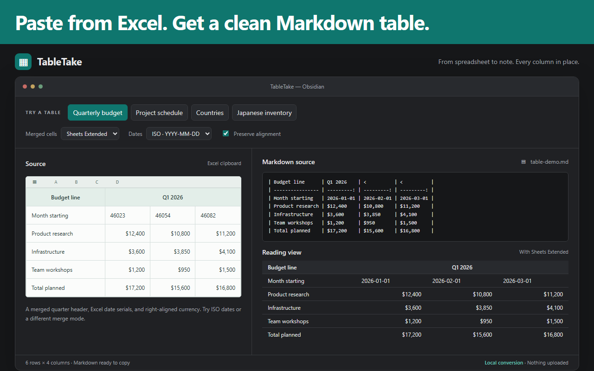

# TableTake for Obsidian

Paste tables from Excel, Google Sheets, LibreOffice, Numbers, or web pages as clean Markdown tables. Columns stay where they were, even with merged cells. TableTake escapes pipes, keeps cell line breaks, lines up columns, and (Pro) keeps merged cells, real dates and alignment.

| Feature | Free | Pro |
| --- | --- | --- |
| Automatic HTML/TSV paste and explicit CSV/TSV conversion | Yes | Yes |
| Header options, column padding, empty-edge trimming, numeric alignment | Yes | Yes |
| Preview with free options | Yes | Yes |
| Merged cells: repeat, Sheets Extended markers, HTML output | — | Yes |
| Date normalization and custom formats | — | Yes |
| Source alignment and inline bold, italic, links | — | Yes |
| Re-format table under cursor | — | Yes |

Free output leaves covered merged cells blank. Automatic paste requires at least two rows and two columns; plain-text automatic conversion requires tabs. Ordinary prose and CSV paste keep their usual behavior. Use the explicit commands for CSV.

## Commands

- **Paste as Markdown table**: read the clipboard and insert a table.
- **Paste as Markdown table with preview…**: inspect Markdown and rendered output, adjust options, then Insert (Enter) or Cancel.
- **Re-format table under cursor** (Pro): re-render contiguous pipe-prefixed table lines using current settings.
- **Convert selected TSV/CSV to table**: replace selected delimited text with a table.

Normal editor undo restores converted pastes. Tables inserted within a line receive blank lines on either side.

## Privacy and permissions

- **Clipboard access**: TableTake reads the clipboard only when you paste (automatic conversion) or run a paste command, to turn copied spreadsheet cells into a Markdown table. Clipboard content is processed locally and never sent anywhere.
- **Storage**: settings and the licence/device state are kept with Obsidian's plugin data (`data.json`). Nothing is written to browser storage.
- **Network**: only licence activation/validation for Pro talks to a server; free features work fully offline.

## Settings

Enable or disable automatic conversion. Set merged-cell mode, date handling/format/order, source and numeric alignment, inline formatting, header row, column padding, and empty-edge trimming. Automatic headers currently use the first row. Pro controls remain visible and locked for free users. Activate or deactivate your licence in Settings → TableTake.

## Payment disclosure

TableTake Pro is a **one-time $19 licence**. Free features never expire. Production activation is not yet open in this build; signing-key configuration is pending.

Activation contacts license.earthloomholdings.com once and sends the licence key, product identifier, and a random device ID. Licence operations are the only network requests: the client also refreshes signed entitlements when due and contacts the server on deactivation. Cached entitlements are verified locally and work offline while valid. No table content is sent.

## Privacy

No telemetry, analytics, or table uploads. Settings, the random device ID, and licence credentials are stored in the plugin's `data.json` inside your vault configuration; consider this when sharing or syncing that file.

[Privacy policy](https://earthloom-legal.pages.dev/apps/tabletake/privacy) · [Terms](https://earthloom-legal.pages.dev/apps/tabletake/terms)

## Sheets Extended compatibility

Pro's Sheets Extended merge mode emits `<` and `^` markers. Install Sheets Extended separately to render those merged cells; TableTake converts the clipboard and does not replace its renderer.

## Support and licence

Contact [info@earthloomholdings.com](mailto:info@earthloomholdings.com).

Plugin source is licensed under the MIT licence. Pro feature access is sold separately.
